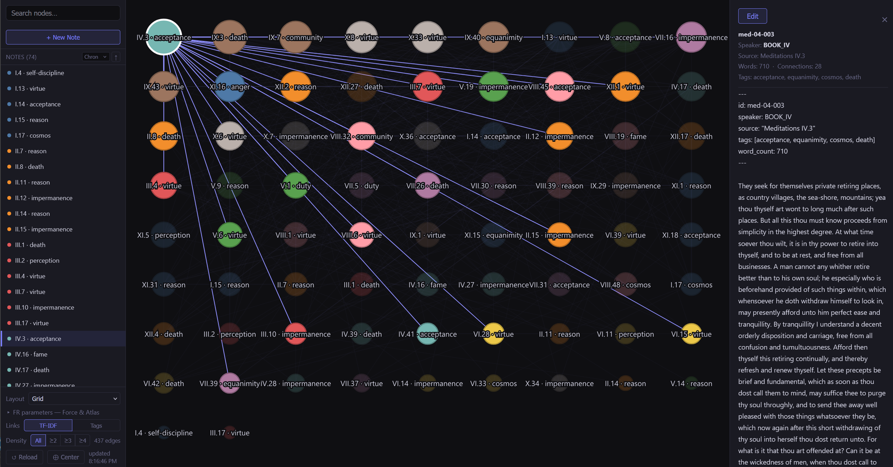
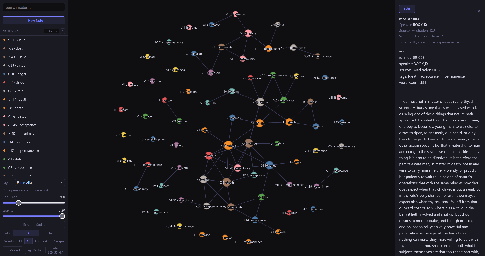

# Note Networks — Portable Zettelkasten with Live Semantic Graph

Turn a folder of markdown notes into an interactive, self-updating knowledge graph — with no cloud services, no internet connection required after setup.

---

## Screenshots


*Grid layout — 74 passages from Marcus Aurelius's Meditations, node size by degree centrality*


*Force Atlas layout — same corpus, organic clustering by thematic similarity*

---

## Use case

You have a body of text you want to think with: research notes, book excerpts, meeting summaries, a reading journal. You want to see the structure — which ideas cluster, which are hubs everything passes through, which sit isolated at the edges.

Note Networks does that. You write short atomic notes, one idea per file. The tool reads them, builds connections between notes based on shared vocabulary or shared tags, and draws the result as a navigable graph.

The graph updates live as you write. Open a note in your editor, save, and the browser re-renders within a few seconds — no manual rebuild, no page refresh.

---

## What you get

- **Two link methods** — TF-IDF vocabulary co-occurrence (algorithmic, from text) or tag-based Jaccard (from your own annotations); switch between them in the viewer
- **Live reload** — file watcher + HEAD poll, updates in ~3 seconds
- **Interactive viewer**: pan, zoom, click a node to read it, hover an edge to see shared terms or tags
- **12 layout algorithms** — Force (FR), Force Atlas, Kamada-Kawai, spectral, circular, concentric, and more
- **Edge density filter** — collapse the graph from all edges down to only the strongest connections with a single click
- **Gephi-aligned physics controls** — Repulsion and Gravity sliders that match the parameters Gephi users already know
- **Scrollable note list** with sort by title, chronology, or degree centrality
- **Write UI** — create, edit, and delete notes directly from the browser or desktop app
- **Multiple networks** — maintain separate corpora and switch between them with a single flag
- **Two runtimes from one codebase** — Python + browser for quick start, or native desktop app (Tauri + Rust) for a real installable product
- **Fully local** — no account, no API key, no data leaves your machine

---

## Quickstart (Python + browser)

```bash
git clone https://github.com/tawhetsell/note-networks.git
cd note-networks
pip install -r requirements.txt
python tools/watch.py
```

Your browser opens automatically. If you close the tab, reopen it with the link `watch.py` prints (`http://localhost:8765/login?token=…`). The token is a per-session password that changes on every restart, so other user accounts on the same machine can't reach your notes.

This launches the Aurelius demo corpus. To start your own network, see [Multiple networks](#multiple-networks) below.

### Or run as a desktop app

A native cross-platform desktop build (Tauri + Rust) is available under [`desktop/`](desktop/). See [Desktop app](#desktop-app) below — no HTTP server, no open ports, all CRUD over IPC.

---

## Note format

Each note needs a YAML frontmatter block:

```yaml
---
id: my-note-001
speaker: ME           # drives node color — use author, project, domain, or any grouping
source: "My source"   # shown in the side panel when you click a node
tags: [idea, concept]
word_count: 80
---

Note body goes here.
```

The `notes/` folder inside each network supports subdirectories. `build_graph.py` walks the full tree.

---

## How it works

```
networks/<name>/notes/*.md
    │
    ▼
tools/build_graph.py
    ├─ Strip YAML frontmatter, tokenize, remove stopwords
    ├─ TF-IDF: score each term tf × log(N / (1 + df))
    ├─ Keep top-25 distinctive terms per note
    └─ Draw an edge between any two notes sharing a top-25 term
    │
    ▼
networks/<name>/data/graph.json     nodes + edges + metadata
    │
    ▼
viz/graph.html
    ├─ d3 v7 force simulation (Fruchterman–Reingold + Force Atlas)
    ├─ Node size = degree centrality
    ├─ Click node  → side panel with full note body + edit/delete controls
    ├─ Hover edge  → tooltip showing shared terms or tags
    ├─ Links toggle → switch between TF-IDF and tag-based edges live
    └─ HEAD poll every 3 s → auto-reload on graph change
```

**TF-IDF** down-weights words that appear across many notes and surfaces terms distinctive to a small number. An edge forms only when a term ranks in the top-25 for *both* notes — this cuts noise from common words that slip past the stopword list.

**Tag-based edges** connect notes that share tags you annotated yourself. Edge weight equals the number of shared tags, so the density filter lets you show only notes with two or more tags in common — a sparser, more intentional view of your corpus.

### BM25 variant

For corpora where note length varies significantly, BM25 scoring gives better results than plain TF-IDF by saturating term frequency and normalising for document length:

```bash
python tools/build_graph.py --method bm25 --corpus networks/my-notes
```

---

## Multiple networks

Each network is a self-contained folder under `networks/`. The repo ships with two:

```
networks/
  aurelius/     ← demo corpus (74 passages from Marcus Aurelius's Meditations)
  my-notes/     ← empty starter, ready to populate
```

Launch any network by name:

```bash
# Demo
python tools/watch.py networks/aurelius

# Your own notes
python tools/watch.py networks/my-notes
```

**To create a new network:**

```bash
mkdir networks\my-new-network\notes   # Windows
mkdir -p networks/my-new-network/notes   # macOS / Linux
python tools/watch.py networks/my-new-network
```

That's all. The server creates the `data/` folder on first run, writes an empty graph, and opens the browser. Start creating notes from the UI or drop `.md` files into the `notes/` folder directly.

### macOS / Linux shell script

```bash
./note-networks-mac-linux.sh                 # launches aurelius (default)
./note-networks-mac-linux.sh my-notes        # launches a named network
./note-networks-mac-linux.sh my-new-network
```

---

## Desktop app

A native desktop build lives in [`desktop/`](desktop/), structured as a Cargo workspace:

- **`core/`** — portable Rust library that mirrors `tools/build_graph.py`. TF-IDF, BM25, tokenization, frontmatter parsing, note CRUD. No UI or Tauri dependencies — reusable from any future binding (mobile, plugins, etc.).
- **`cli/`** — Rust replacement for `build_graph.py`, useful if you want to drop Python from your build pipeline:
  ```bash
  cd desktop
  cargo run --bin note-graph -- --corpus ../networks/aurelius
  ```
- **`src-tauri/`** — Tauri shell that opens a native window, talks to the Rust core over IPC, and reuses the same `viz/graph.html` frontend the Python server uses.

**To build / run the desktop app:**

```bash
cd desktop
npm install         # installs the Tauri CLI (one time)
npm run dev         # opens the dev window
npm run build       # produces a release .msi / .dmg installer
```

Prerequisites: Rust toolchain (`rustup default stable-x86_64-pc-windows-msvc` on Windows), Microsoft C++ Build Tools on Windows, Node.js 18+, Xcode Command Line Tools on macOS.

The frontend (`viz/graph.html`) is **the same file** used by the Python server. It detects its runtime at boot and routes API calls to either Tauri IPC or HTTP. You can keep both runtimes installed and switch between them without touching the visualization layer.

---

## Folder structure

```
note-networks/
├── networks/
│   ├── aurelius/
│   │   ├── notes/                ← Meditations passages (Markdown)
│   │   ├── data/                 ← generated: graph.json, co_occurrence.csv
│   │   ├── Aurelius_text.md      ← source text (Project Gutenberg)
│   │   └── seed_from_aurelius.py ← re-generates the demo notes from source
│   └── my-notes/
│       └── notes/                ← empty, ready for your notes
├── tools/
│   ├── build_graph.py            ← Python: notes/ → data/graph.json  (--method tfidf|bm25)
│   └── watch.py                  ← file watcher + HTTP server + write API (port 8765)
├── viz/
│   └── graph.html                ← shared frontend — works in browser AND Tauri (d3 v7)
├── desktop/                      ← native desktop app (Cargo workspace)
│   ├── core/                     ← portable Rust graph-building library
│   ├── cli/                      ← Rust CLI (drop-in replacement for build_graph.py)
│   ├── src-tauri/                ← Tauri shell (Rust backend + IPC commands)
│   └── package.json              ← Tauri CLI deps (npm install once)
└── requirements.txt              ← Python deps for the watch.py path
```

---

## Requirements

**Python + browser path (default):**
- Python 3.10+
- `watchdog` — see `requirements.txt`
- A modern browser

No Node.js, no build step, no database, no network access needed. `d3.js` (v7.9.0) is bundled in `viz/vendor/` rather than loaded from a CDN.

| Platform | Command |
|---|---|
| macOS / Linux | `python3 tools/watch.py [networks/<name>]` |
| Windows | `python tools/watch.py [networks/<name>]` |

**Desktop app path (optional):**
- Rust toolchain (stable, MSVC variant on Windows)
- Node.js 18+ (used only for the Tauri CLI tooling)
- Microsoft C++ Build Tools on Windows / Xcode CLT on macOS

See [Desktop app](#desktop-app) above for the build commands.

---

## Demo corpus

The repo ships with 74 passages from Marcus Aurelius's *Meditations* (Casaubon translation, Project Gutenberg), annotated with Stoic theme tags. To regenerate the notes from the source text:

```bash
python networks/aurelius/seed_from_aurelius.py
python tools/watch.py networks/aurelius
```

The TF-IDF and Tags link methods produce visually distinct graphs of the same corpus — a useful illustration of how the two approaches differ.

---

## Roadmap

| Version | Feature |
|---|---|
| V1 (current) | TF-IDF and tag-based links, 12 layout algorithms, live reload, write UI, multiple networks, dual runtime (Python server + Tauri desktop app) |
| V1.1 | Event-based reload (replace HTTP polling with Tauri events), in-app network picker, packaged installers (.msi / .dmg) |
| V2 | Named-entity extraction (spaCy) for person / place / concept nodes |
| V3 | Sentence-transformer embeddings for semantic similarity; iOS capture app via Obsidian Sync or iCloud-shared vault |

---

## Acknowledgements

Layout algorithms and physics parameter conventions are modelled on [Gephi](https://gephi.org/), the open-source network visualisation platform. The Repulsion / Gravity slider names, the Force Atlas degree-weighted repulsion, and the Kamada-Kawai stress-minimisation approach all follow Gephi's design. Gephi remains the reference tool for serious network analysis; Note Networks borrows its vocabulary to make the physics controls familiar to anyone who has used it.

---

## Built with Claude Code

This application was built with [Claude Code](https://claude.com/claude-code) running inside the VS Code extension. The graph layout algorithms, TF-IDF pipeline, live-reload watcher, and interactive viewer were all designed and implemented through an iterative conversation with the agent.
